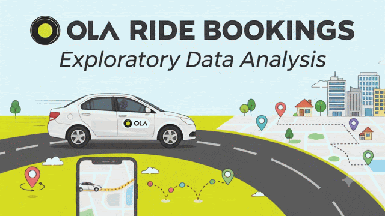

<!-- Animated Wave Header -->

<!-- Animated Typing Banner -->

 

<!-- Custom Uploaded GIF Showcase -->

  

<!-- Tech Stack Badges -->

 

---

## 📌 Project Overview

An end-to-end Exploratory Data Analysis (EDA) of **150,000 Ola ride bookings** (`21` columns) built in Python to examine ride demand, identify why **`38.0%` (`57,000`)** of bookings fail to complete, evaluate fleet revenue performance, test fare-distance pricing behavior, and measure how driver arrival times (`Avg VTAT`) impact customer cancellations.

---

## 🎯 Business Questions Explored

1. **Incomplete & Cancelled Rides:** Are incomplete or cancelled rides driven by vehicle type, payment method, fare price, or pickup/drop location?
2. **Vehicle Performance:** Which vehicle type generates the highest total revenue and ride volume?
3. **Pricing & Distance:** Does ride fare (`Booking Value`) depend on pickup location or trip distance (`Ride Distance`)?
4. **Waiting Times (`VTAT` vs. `CTAT`):** How do driver arrival time (`Avg VTAT`) and trip duration (`Avg CTAT`) impact ride completion and cancellations?

---

## 🧹 Data Cleaning & Validation Highlights

* **Dataset Scale & Schema:** Verified **`150,000` rows** and **`21` columns** across dates, times, IDs, booking statuses, vehicle types, locations, turnaround times, ratings, payment methods, and cancellation/incomplete flags.
* **Duplicate & ID Sanitization:** Confirmed **`0` exact duplicate rows**, identified **`1,233` recycled `Booking ID`s** belonging to distinct trips/customers (retaining all `150,000` records), and stripped extra quotation marks (`"`) from `Booking ID` and `Customer ID`.
* **Datetime & Event Flag Normalization:** Converted `Date` to `datetime`, extracted `Hour` (`0–23`) from `Time`, filled missing event flags (`Cancelled Rides by Customer`, `Cancelled Rides by Driver`, `Incomplete Rides`) with `0` as integers, and verified `0` zero or negative fares or distances.
* **Structural Missingness Preserved:** Kept structural `NaN`s intact across `Booking Value`, `Ride Distance`, `Payment Method`, `Avg VTAT`, `Avg CTAT`, and cancellation/incomplete reason columns (present across the `102,000` started rides vs. `48,000` cancelled/no-driver rides) so averages remain undistorted.

---

## 📊 Key Findings

| Focus Area | Key Analytical Finding |
| :--- | :--- |
| **Overall Fulfillment** | **`62.0%` (`93,000` rides)** were completed and **`38.0%` (`57,000` rides)** failed to complete — led by **driver cancellations (`18.0%`)**, followed by **customer cancellations (`7.0%`)**, **no driver found (`7.0%`)**, and **incomplete trips (`6.0%`)**. |
| **Uniform Failure Rates** | Completion and failure shares stay nearly identical across all vehicle types, payment methods (`Cash`, `UPI`, `Credit Card`, `Debit Card`, `Uber Wallet`), fare tiers, and pickup-drop routes — pointing to platform-wide friction rather than a single isolated segment. |
| **Revenue Concentration** | **Auto** generates the highest cumulative booking value due to high ride volume, while average fares stay consistent across top pickup locations. |
| **Fare vs. Distance** | Pearson correlation between `Ride Distance` and `Booking Value` is near zero (`r ≈ 0.005`), indicating fares do not scale linearly with distance in this dataset. |
| **Wait Time Impact (`VTAT`)** | Customer-cancelled rides show a higher mean driver arrival wait time (**`12.5 mins`**) than completed trips (**`8.5 mins`**), indicating longer pickup waits increase rider cancellations before trip start. |

---

## 💡 Business Recommendations

1. **Curb Driver Cancellations First:** Because driver cancellations account for nearly half of all unfulfilled bookings (`18.0%` of total demand), introduce stricter penalty thresholds or targeted peak-hour completion bonuses to improve driver acceptance follow-through.
2. **Reduce Pickup Wait Times (`Avg VTAT`):** Tighten dispatch radius matching during peak demand windows and surface real-time driver ETA alerts to keep `Avg VTAT` closer to the **`8.5-minute`** completed-ride benchmark and prevent customer cancellations.
3. **Protect High-Volume Fleet Supply:** Since **Auto** drives the largest share of cumulative booking value, prioritize driver availability and fast dispatch for Auto requests to protect top-line revenue.

---

## 🗂️ Files in This Folder

* [`OLA_Ride_Bookings_EDA.ipynb`](./OLA_Ride_Bookings_EDA.ipynb) — Full Google Colab / Jupyter Notebook with code, tables, charts, and first-person commentary.
* [`Gemini_Generated_Gif_khnncfkhnncfkhnn.gif`](./Gemini_Generated_Gif_khnncfkhnncfkhnn.gif) — Animated project banner.
* [`README.md`](./README.md) — Project overview, findings, and recommendations.

---

[⬅️ Back to Python EDA Portfolio](../README.md)

 

<!-- Animated Wave Footer -->

